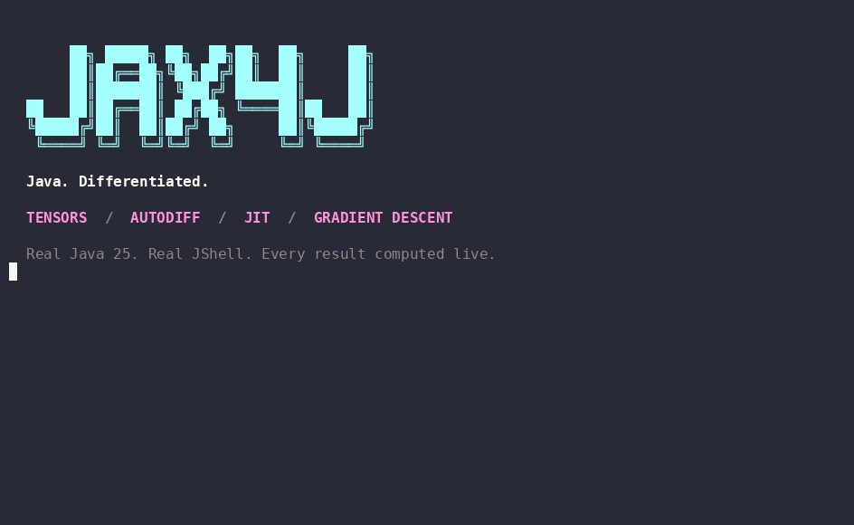

# Java. Differentiated.

A colorful, narrated JShell tour: tensors and `vmap`, first and second
derivatives, cached JIT replay, and gradient descent. About one minute, using
the CPU backend so the session runs without GPU hardware or native libraries.
All numerical output comes from a live Java 25 JShell process running JAX4J.



## Run or replay

Requires JDK 25+, Maven and Python 3. Set `JAVA_HOME` if `jshell` is not on
your `PATH`. Run from the repository root:

```sh
mvn -pl jax4j-core -am -DskipTests compile
python3 demo/jax4j.py
python3 demo/jax4j.py --fast  # execute and validate without presentation delays
```

The small `show(Tensor)` helper prints tensor values; `lossRow` formats the
training progress. Both are defined during session setup. The demo forces CPU
execution and presents no GPU timing or throughput claims. Temporary tensors
used in the short presentation live until JShell exits; application code should
close tensor results after use.

Replay the checked-in [asciicast v2 recording](jax4j.cast) with
[asciinema](https://docs.asciinema.org/manual/cli/):

```sh
asciinema play demo/jax4j.cast
```

## Regenerate the assets

```sh
python3 demo/jax4j.py --record demo/jax4j.cast
agg --theme dracula --font-size 16 --line-height 1.25 \
    --fps-cap 15 --last-frame-duration 4 demo/jax4j.cast demo/jax4j.gif
```

The player writes ANSI colors and real elapsed timestamps to the cast; it
requires no Python packages. The GIF uses [agg](https://github.com/asciinema/agg)
(generated with version 1.9.0). Keep the 96 × 28 terminal dimensions when
rendering. GitHub READMEs display the GIF directly; the cast remains available
for terminal playback without a third-party hosting account.

The presentation follows the narrated JShell format of the historical
[NablaTensor GPU demo](https://github.com/nablatensor-dev/quant/tree/06298ff4da27/demo),
whose [animated preview](https://github.com/nablatensor-dev/quant/blob/06298ff4da27/docs/assets/greeks-on-gpu.gif)
appeared in the old NablaTensor README. This session uses current JAX4J APIs.
